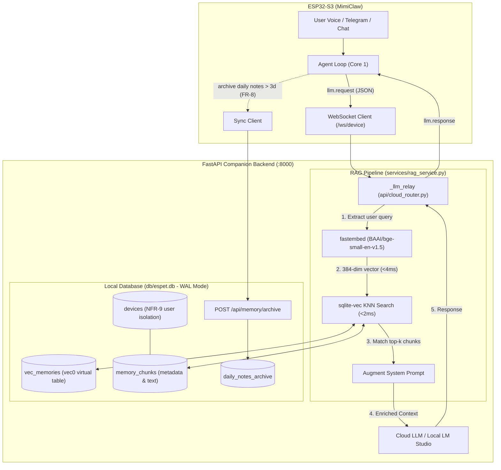

# SQLite-Vec Long-Term Memory & RAG Plan

## 1. Architecture Flow



---

## 2. Database Schema (`db/espet.db`)

```sql
PRAGMA journal_mode = WAL;

-- NFR-9: Device-to-user binding & query isolation
CREATE TABLE IF NOT EXISTS devices (
    device_id TEXT PRIMARY KEY,
    user_id TEXT NOT NULL,
    device_name TEXT DEFAULT 'ESPET',
    bound_at TIMESTAMP DEFAULT CURRENT_TIMESTAMP
);

-- Granular memory chunks
CREATE TABLE IF NOT EXISTS memory_chunks (
    id INTEGER PRIMARY KEY AUTOINCREMENT,
    user_id TEXT NOT NULL,
    device_id TEXT NOT NULL,
    source_type TEXT NOT NULL,     -- 'memory_md', 'daily_note', 'quick_note'
    source_ref TEXT,               -- 'MEMORY.md', '2026-11-06.md'
    chunk_index INTEGER DEFAULT 0,
    content TEXT NOT NULL,
    metadata_json TEXT,
    created_at TIMESTAMP DEFAULT CURRENT_TIMESTAMP,
    updated_at TIMESTAMP DEFAULT CURRENT_TIMESTAMP,
    FOREIGN KEY (device_id) REFERENCES devices(device_id)
);

CREATE INDEX IF NOT EXISTS idx_chunks_user ON memory_chunks(user_id, source_type);

-- sqlite-vec virtual table (384-dim float vector)
CREATE VIRTUAL TABLE IF NOT EXISTS vec_memories USING vec0(
    chunk_id INTEGER PRIMARY KEY,
    embedding float[384]
);

-- FR-8: Aged daily notes archive (>3 days offloaded from SPIFFS)
CREATE TABLE IF NOT EXISTS daily_notes_archive (
    id INTEGER PRIMARY KEY AUTOINCREMENT,
    user_id TEXT NOT NULL,
    device_id TEXT NOT NULL,
    note_date TEXT NOT NULL,
    raw_content TEXT NOT NULL,
    archived_at TIMESTAMP DEFAULT CURRENT_TIMESTAMP,
    UNIQUE(user_id, note_date)
);
```

---

## 3. Files Affected

### Backend
1. `espet-backend/requirements.txt`: Add `sqlite-vec>=0.1.9`, `fastembed>=0.9.1`.
2. `espet-backend/config.py`: Add `sqlite_db_path="db/espet.db"`, `rag_top_k=3`, `rag_threshold=0.72`.
3. `espet-backend/services/memory_db.py` (New): SQLite connection manager, loads `sqlite_vec`, WAL mode, creates tables.
4. `espet-backend/services/rag_service.py` (New): `fastembed` model runner, chunker, vector search, prompt injector.
5. `espet-backend/api/cloud_router.py`: Hook `_llm_relay()` to intercept query, run RAG, and inject context before LLM call.
6. `espet-backend/api/memory_router.py` (New): REST endpoints (`POST /api/memory/query`, `POST /api/memory/archive`).
7. `espet-backend/config_store.py`: Auto-chunk and re-embed `MEMORY.md` into `espet.db` on web save.
8. `espet-backend/api/custom_tools.py`: Expose `memory_search` tool to agent loop via MCP.

### Dashboard UI
1. `espet-backend/src/views/Memory.tsx`: Add vector search tester (shows match score + ms latency) and chunk browser.

---

## 4. Expected Output Formats

### Injected LLM Context
```markdown
## Retrieved Long-Term Memory (via sqlite-vec)
- [MEMORY.md]: Supervisor Dr. Wong consultation: Thursday 2:00 PM, Block B.
- [2026-10-24.md]: Prefers silent glanceable OLED cards during study hours.
```

### Backend Log Output (NFR-5 Latency Compliance)
```text
[INFO] rag: Query 'When is Dr Wong meeting?' (device: espet_s3_01)
[INFO] rag: Embedded query in 3.1 ms (384-dim BAAI/bge-small-en-v1.5)
[INFO] rag: sqlite-vec search in 1.4 ms — 2 chunks matched (distance < 0.25)
[INFO] cloud: Injected 2 memory chunks into prompt for LLM relay
```

---

## 5. Execution Steps & Time Estimates

1. **Step 1: Core DB & Dependencies** (~20 min): Install packages, create `services/memory_db.py`, initialize schema.
2. **Step 2: Vector Engine** (~30 min): Build `services/rag_service.py` with `fastembed` and `sqlite-vec`.
3. **Step 3: Relay Interceptor** (~15 min): Wire RAG injection into `cloud_router.py:_llm_relay`.
4. **Step 4: Endpoints & Sync** (~20 min): Add `memory_router.py` and hook `config_store.py`.
5. **Step 5: Dashboard Test UI** (~25 min): Add RAG test search bar in `Memory.tsx`.
6. **Step 6: Latency Benchmark** (~10 min): Measure retrieval speed against NFR-5 (<10 ms).
