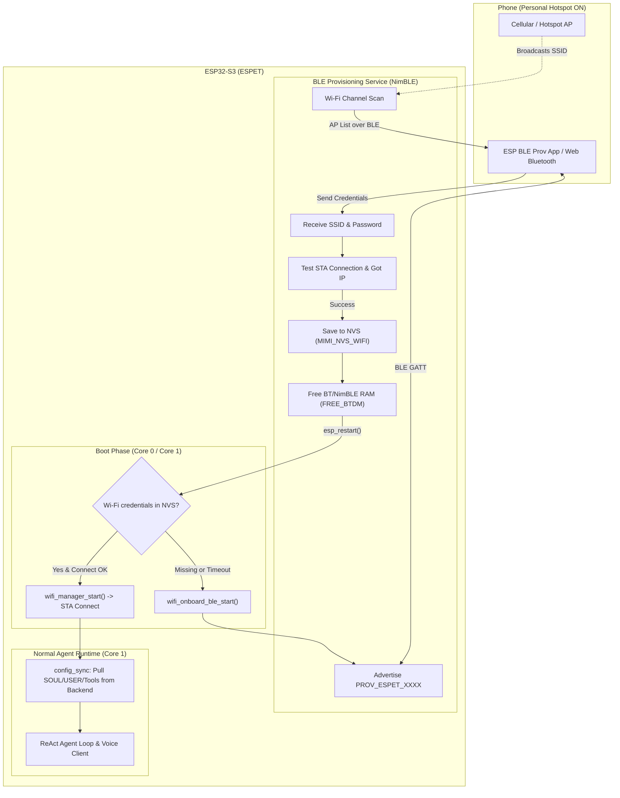

# BLE Wi-Fi Provisioning (Approach A) Implementation Plan

## 1. Problem & Architecture Flow

### Problem
When setting up ESPET Wi-Fi with a single phone mobile hotspot:
1. Phone connects to ESPET SoftAP (`MimiClaw-XXXX`).
2. Phone OS disables Personal Hotspot automatically (cannot run STA and AP simultaneously).
3. ESP32 Wi-Fi scan cannot find phone hotspot; user must type SSID/password blind.

### Solution
Use Bluetooth Low Energy (BLE) provisioning via ESP-IDF `wifi_provisioning` and Apache NimBLE.
* Phone Personal Hotspot remains active (Bluetooth does not interrupt cellular/Wi-Fi hotspot).
* ESPET advertises `PROV_ESPET_XXXX` over BLE.
* ESPET scans 2.4 GHz channels and passes the AP list to phone over BLE.
* User taps hotspot name, enters password; ESPET connects, verifies STA IP, saves credentials to NVS (`MIMI_NVS_WIFI`), and deinitializes BLE, releasing all Bluetooth RAM back to heap.
* Normal boot connects directly to phone hotspot. BLE never initializes.



---

## 2. Configuration & Dependencies

### Kconfig (`sdkconfig.defaults.esp32s3` & `sdkconfig`)
Enable Apache NimBLE (saves ~100 KB RAM over Bluedroid; no Classic BT overhead):

```ini
CONFIG_BT_ENABLED=y
CONFIG_BT_NIMBLE_ENABLED=y
CONFIG_BT_NIMBLE_MEM_ALLOC_MODE_INTERNAL=y
```

### Component CMakeLists (`main/CMakeLists.txt`)
Add source file and required IDF components:

```cmake
idf_component_register(
    SRCS
        ...
        "onboard/wifi_onboard_ble.c"
    INCLUDE_DIRS
        "."
    REQUIRES
        ...
        wifi_provisioning bt protocomm
)
```

---

## 3. Implementation Details

### 3.1 Header: `main/onboard/wifi_onboard_ble.h`
Public interface for BLE onboarding:

```c
#pragma once

#include "esp_err.h"

#ifdef __cplusplus
extern "C" {
#endif

/**
 * Start BLE Wi-Fi provisioning service.
 * Advertises PROV_ESPET_XXXX over BLE, handles Wi-Fi scanning and
 * credential exchange with phone app/web, tests connection,
 * saves credentials to NVS, and restarts device.
 * Blocks until provisioning finishes.
 */
esp_err_t wifi_onboard_ble_start(void);

#ifdef __cplusplus
}
#endif
```

### 3.2 Implementation: `main/onboard/wifi_onboard_ble.c`
* **Device Name**: `PROV_ESPET_%02X%02X` using last 2 bytes of base MAC address.
* **Security Mode**: `WIFI_PROV_SECURITY_0` (plain text BLE communication for frictionless personal device onboarding).
  `// ponytail: Security 0 used for personal companion; upgrade to Security 1 (PoP) if deployed in untrusted public environments.`
* **Memory Management**: Configure `.scheme_event_handler = WIFI_PROV_SCHEME_BLE_EVENT_HANDLER_FREE_BTDM` to free all NimBLE/controller RAM back to system heap on completion.
* **Events**:
  * `WIFI_PROV_CRED_RECV`: Extract SSID/password, call `wifi_manager_set_credentials()`.
  * `WIFI_PROV_CRED_SUCCESS`: Update OLED display (`WiFi Connected`).
  * `WIFI_PROV_CRED_FAIL`: Report authentication failure; display error on OLED.
  * `IP_EVENT_STA_GOT_IP`: Display assigned IP address.
* **Exit**: Block on `wifi_prov_mgr_wait()`, deinitialize manager, delay 2 seconds, invoke `esp_restart()`.

### 3.3 Boot Wiring: `main/mimi.c`
Replace captive portal fallback in `app_main`:

```c
    if (!wifi_ok) {
        ESP_LOGW(TAG, "Entering WiFi BLE onboarding mode...");
        wifi_onboard_ble_start();  /* blocks, restarts on success */
        return;  /* unreachable */
    }
```
Remove/disable secondary admin SoftAP (`wifi_onboard_start(WIFI_ONBOARD_MODE_ADMIN)`) to eliminate open hotspot clutter.

### 3.4 CLI Command: `main/cli/serial_cli.c`
Register `wifi_prov` command to trigger re-provisioning on demand:

```c
static int cmd_wifi_prov(int argc, char **argv)
{
    (void)argc;
    (void)argv;
    printf("Erasing Wi-Fi credentials and rebooting into BLE provisioning...\n");
    nvs_handle_t nvs;
    if (nvs_open(MIMI_NVS_WIFI, NVS_READWRITE, &nvs) == ESP_OK) {
        nvs_erase_key(nvs, MIMI_NVS_KEY_SSID);
        nvs_erase_key(nvs, MIMI_NVS_KEY_PASS);
        nvs_commit(nvs);
        nvs_close(nvs);
    }
    vTaskDelay(pdMS_TO_TICKS(500));
    esp_restart();
    return 0;
}
```

---

## 4. Files Affected

1. `sdkconfig.defaults.esp32s3`: Add `CONFIG_BT_ENABLED=y`, `CONFIG_BT_NIMBLE_ENABLED=y`, `CONFIG_BT_NIMBLE_MEM_ALLOC_MODE_INTERNAL=y`.
2. `main/CMakeLists.txt`: Register `onboard/wifi_onboard_ble.c` in `SRCS`; add `wifi_provisioning`, `bt`, `protocomm` to `REQUIRES`.
3. `main/onboard/wifi_onboard_ble.h` (New): Header file for BLE onboarding service.
4. `main/onboard/wifi_onboard_ble.c` (New): Implementation using `wifi_prov_mgr` + `wifi_prov_scheme_ble`.
5. `main/mimi.c`: Call `wifi_onboard_ble_start()` when `!wifi_ok`.
6. `main/cli/serial_cli.c`: Register `wifi_prov` command.
7. `.agent/SYSTEM_OVERVIEW.md`: Document BLE onboarding and update changelog.

---

## 5. Verification & Expected Logs

### 5.1 Build Verification
Compile firmware with ESP-IDF v5.5.4:

```bash
powershell.exe -NoProfile -ExecutionPolicy Bypass -Command "& 'C:\Espressif\tools\Microsoft.v5.5.4.PowerShell_profile.ps1' | Out-Null; cd C:\repository\espet; idf.py build"
```
Expected output:
```text
mimiclaw.bin binary size 0x1a0150 bytes. Smallest app partition is 0x300000 bytes. 0x15feb0 bytes (46%) free.
```

### 5.2 Device Boot Logs (First Boot / No Credentials)
```text
[wifi] No WiFi credentials configured
[mimi] Entering WiFi BLE onboarding mode...
[onboard_ble] ========================================
[onboard_ble]   Starting BLE Wi-Fi Provisioning
[onboard_ble] ========================================
[onboard_ble] BLE device name: PROV_ESPET_F1ED
[onboard_ble] BLE provisioning started
[onboard_ble] Open 'ESP BLE Provisioning' app on phone or Chrome Web Bluetooth
[onboard_ble] Connect to 'PROV_ESPET_F1ED' to configure Wi-Fi
```

### 5.3 OLED Screen States
* During BLE advertising:
  * Line 1: `WiFi Setup (BLE)`
  * Line 2: `PROV_ESPET_XXXX`
* On Connection Success:
  * Line 1: `WiFi Connected`
  * Line 2: `172.20.10.3` (or phone hotspot client IP)

### 5.4 Provisioning Exchange Logs
```text
[onboard_ble] Received Wi-Fi credentials for SSID: MyPhoneHotspot
[wifi] WiFi credentials saved for SSID: MyPhoneHotspot
[wifi] Connected! IP: 172.20.10.3
[onboard_ble] Provisioning successful!
[onboard_ble] Provisioning ended
[onboard_ble] Provisioning complete. Restarting in 2s...
```

### 5.5 Subsequent Boot Logs (Normal Operation)
```text
[wifi] Connecting to SSID: MyPhoneHotspot
[wifi] Connected! IP: 172.20.10.3
[backend_discovery] Discovered backend: http://172.20.10.2:8000
[config_sync] Sync complete: USER.md, SOUL.md, MEMORY.md up to date
```
BLE stack is not initialized on normal boots. Zero RAM overhead.

---

## 6. Execution Steps & Time Estimates

1. **Step 1: Kconfig & Dependencies** (~10 min): Update `sdkconfig.defaults.esp32s3`, `sdkconfig`, and `main/CMakeLists.txt`.
2. **Step 2: BLE Service Implementation** (~25 min): Create `wifi_onboard_ble.h` and `wifi_onboard_ble.c`.
3. **Step 3: Lifecycle Integration** (~10 min): Wire `wifi_onboard_ble_start()` into `main/mimi.c`.
4. **Step 4: Serial CLI Command** (~5 min): Add `wifi_prov` command to `main/cli/serial_cli.c`.
5. **Step 5: Compilation & Build Verification** (~10 min): Run `idf.py build` and verify binary fits partition.
6. **Step 6: End-to-End Flash Test** (~15 min): Flash board, test pairing via phone hotspot, verify auto-restart and backend sync.
