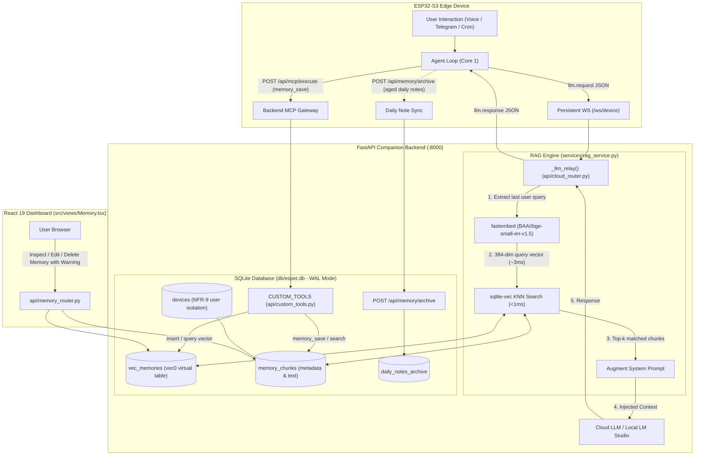

# Implementation Plan — SQLite-Vec Long-Term Memory & RAG for ESPET

## Context

ESPET is an embodied AI assistant running on ESP32-S3 with a companion FastAPI backend. Per FYP Report Objectives O3 (FR-8, FR-9) and Non-Functional Requirements NFR-5 (<10ms retrieval), NFR-8 (local data sovereignty), and NFR-9 (device-to-user query isolation), the agent requires a fast, persistent long-term memory system.
On-device `MEMORY.md` is strictly a short summary of who ESPET is (<2KB) synchronized to flash. It cannot hold unbounded historical memory. Long-term memory lives in backend SQLite (`db/espet.db`) indexed with `sqlite-vec` (384-dim float vectors) and `fastembed` (`BAAI/bge-small-en-v1.5`). The system must ground conversations and autonomous actions in past events, present long-term memories as a searchable/editable list on the React dashboard with explicit modification warnings, and empower AI agents to persist memories autonomously via MCP tools.

---

## 1. Analysis & Completeness Review of `docs/plans/p0611_sqlite.md`

`docs/plans/p0611_sqlite.md` proposed the core foundation (`sqlite-vec` + `fastembed` in `db/espet.db`, `_llm_relay` injection). However, comparison against the FYP Report and explicit operational constraints exposes four critical gaps:

1. **Fundamental Role Confusion (`MEMORY.md` vs Long-Term Store)**:
   - *p0611 flaw*: Assumed `MEMORY.md` on flash is chunked and re-embedded into SQLite on web save as the primary memory source.
   - *Correction*: Per user specification and Chapter 4 (§4.4.1), `MEMORY.md` is only a concise on-device identity/profile summary. The real long-term memory store lives in backend SQLite (`espet.db`) and accumulates memories across interaction history, agent tools, daily note archives, and user inputs. Re-embedding `MEMORY.md` alone leaves the agent amnesic.
2. **Missing Ingestion & Capture Mechanics ("Remember all things done before")**:
   - *p0611 flaw*: No mechanism to create memories during daily runtime. The vector DB would remain empty indefinitely.
   - *Correction*: Dual ingestion pipeline required:
     - Autonomous agent tool `memory_save` via MCP so LLM persists facts/preferences during conversations or tool calls.
     - Automatic post-relay episodic capture in `_llm_relay` after tool execution or notable turns.
     - Daily note archive ingest (`POST /api/memory/archive`) for aged notes offloaded from SPIFFS (FR-8).
3. **Incomplete UI Specification (`Memory.tsx`)**:
   - *p0611 flaw*: Only specified a "vector search tester and chunk browser".
   - *Correction*: User explicitly requires displaying memories as a structured list, allowing add/edit/delete, and presenting a prominent warning dialog before modifying memories to prevent unintentional loss of agent factual grounding.
4. **Agent MCP Tooling Gaps**:
   - *p0611 flaw*: Listed `memory_search` under custom tools but omitted `memory_save`. Without `memory_save`, the ReAct agent loop cannot write to long-term memory during voice/Telegram sessions.

---

## 2. Architecture & Data Flow



---

## 3. Implementation Steps

### Phase 1: Database Foundation & Schema (`services/memory_db.py`)

- **File**: `espet-backend/services/memory_db.py` (New)
- **Dependencies**: Add `sqlite-vec>=0.1.9` and `fastembed>=0.9.1` to `espet-backend/requirements.txt`. (Note: `sqlite-vec` 0.1.9 is verified compatible with Windows x64 Python).
- **SQLite Engine**:
  - Connection manager wrapping `sqlite3.connect("db/espet.db", check_same_thread=False)`.
  - Enable WAL mode: `PRAGMA journal_mode = WAL; PRAGMA synchronous = NORMAL;`.
  - Extension loading:
    ```python
    conn.enable_load_extension(True)
    sqlite_vec.load(conn)
    conn.enable_load_extension(False)
    ```
- **Tables**:
  ```sql
  CREATE TABLE IF NOT EXISTS devices (
      device_id TEXT PRIMARY KEY,
      user_id TEXT NOT NULL,
      device_name TEXT DEFAULT 'ESPET',
      bound_at TIMESTAMP DEFAULT CURRENT_TIMESTAMP
  );

  CREATE TABLE IF NOT EXISTS memory_chunks (
      id INTEGER PRIMARY KEY AUTOINCREMENT,
      user_id TEXT NOT NULL,
      device_id TEXT NOT NULL,
      source_type TEXT NOT NULL,     -- 'fact', 'preference', 'daily_note', 'conversation', 'action'
      source_ref TEXT,               -- 'agent_tool', '2026-11-08.md', 'web_ui', 'relay'
      content TEXT NOT NULL,
      metadata_json TEXT,
      created_at TIMESTAMP DEFAULT CURRENT_TIMESTAMP,
      updated_at TIMESTAMP DEFAULT CURRENT_TIMESTAMP,
      FOREIGN KEY (device_id) REFERENCES devices(device_id)
  );

  CREATE INDEX IF NOT EXISTS idx_chunks_device ON memory_chunks(device_id, source_type);

  CREATE VIRTUAL TABLE IF NOT EXISTS vec_memories USING vec0(
      chunk_id INTEGER PRIMARY KEY,
      embedding float[384]
  );

  CREATE TABLE IF NOT EXISTS daily_notes_archive (
      id INTEGER PRIMARY KEY AUTOINCREMENT,
      user_id TEXT NOT NULL,
      device_id TEXT NOT NULL,
      note_date TEXT NOT NULL,
      raw_content TEXT NOT NULL,
      archived_at TIMESTAMP DEFAULT CURRENT_TIMESTAMP,
      UNIQUE(user_id, note_date)
  );
  ```
- **Default Seed**: Auto-insert default device record `device_id='espet_s3_01'`, `user_id='default_user'` on init.

---

### Phase 2: Embedding & Retrieval Service (`services/rag_service.py`)

- **File**: `espet-backend/services/rag_service.py` (New)
- **Model**: Singleton instance of `fastembed.TextEmbedding("BAAI/bge-small-en-v1.5")`. (Downloads once, caches locally, runs on CPU via ONNX Runtime with ~3ms latency).
- **Functions**:
  1. `get_embedding(text: str) -> list[float]`:
     Encodes single text into 384-dimensional float list.
  2. `add_memory(device_id: str, content: str, source_type: str = "fact", source_ref: str = "web_ui", user_id: str = "default_user") -> int`:
     - Inserts record into `memory_chunks`.
     - Computes 384-dim embedding via `get_embedding()`.
     - Serializes with `sqlite_vec.serialize_float32(vector)`.
     - Inserts into `vec_memories(chunk_id, embedding)`.
     - Returns `chunk_id`.
  3. `update_memory(chunk_id: int, content: str, source_type: str | None = None) -> bool`:
     - Updates `content`, `updated_at`, and optional `source_type` in `memory_chunks`.
     - Re-embeds updated text.
     - Updates `vec_memories` row matching `chunk_id`.
  4. `delete_memory(chunk_id: int) -> bool`:
     - Deletes from `vec_memories WHERE chunk_id = ?`.
     - Deletes from `memory_chunks WHERE id = ?`.
  5. `search(query: str, device_id: str, top_k: int = 3, threshold: float = 0.28) -> list[dict]`:
     - Measures timing with `time.perf_counter()`.
     - Encodes `query` to 384-dim vector (~3ms).
     - Queries `vec_memories` KNN joined with `memory_chunks`:
       ```sql
       SELECT m.id, m.content, m.source_type, m.source_ref, m.created_at, v.distance
       FROM vec_memories v
       JOIN memory_chunks m ON m.id = v.chunk_id
       WHERE m.device_id = ? AND v.embedding MATCH ?
       ORDER BY v.distance
       LIMIT ?
       ```
     - Filters out matches where `v.distance > threshold` (equivalent to cosine similarity < 0.72).
     - Calculates latency in ms. Returns `{"latency_ms": round(elapsed * 1000, 2), "results": [...]}`.
  6. `archive_daily_note(device_id: str, note_date: str, raw_content: str, user_id: str = "default_user") -> int`:
     - Upserts into `daily_notes_archive`.
     - Chunks text into bullet items and paragraphs (>15 chars).
     - Calls `add_memory()` for each chunk with `source_type="daily_note"` and `source_ref=f"{note_date}.md"`.

---

### Phase 3: Prompt Interceptor & Ingestion in `cloud_router.py`

- **File**: `espet-backend/api/cloud_router.py`
- **Hook `_llm_relay(websocket, request_id, body_str, device_id)`**:
  - Pass `device_id` into `_llm_relay` from `ws_device` (line 163: `asyncio.create_task(_llm_relay(websocket, request_id, body_str, device_id))`).
  - Extract latest user query:
    Inspect `body.get("messages", [])`. Find last message with `"role": "user"`.
    If content is string and non-empty:
    - Run `rag_service.search(query_text, device_id=device_id, top_k=settings.rag_top_k)`.
    - If results returned:
      Format markdown block:
      ```markdown
      ## Retrieved Long-Term Memory (via SQLite-Vec RAG):
      - [fact]: Supervisor Dr. Wong consultation: Thursday 2:00 PM, Block B.
      - [preference]: Prefers concise bullet points without pleasantries.
      ```
      Inject into system message (`messages[0]["content"]` or prepend `{"role": "system", "content": ...}`).
      Log: `[INFO] rag: Injected {len(results)} chunks for device {device_id} ({latency_ms} ms)`.
  - **Post-Relay Ingestion (Background)**:
    - If the LLM execution invoked state-changing tools (e.g. `gmail_send_email`, `create_event`) or explicitly returned factual acknowledgments, capture an episodic memory record asynchronously into `memory_chunks` (`source_type="action"` or `"conversation"`).

---

### Phase 4: Agent Memory Tools via MCP (`api/custom_tools.py`)

- **File**: `espet-backend/api/custom_tools.py`
- Expose two custom tools in `CUSTOM_TOOLS` dictionary (automatically discovered by `tools_router.py` and executed via `mcp_router.py`):
  1. `memory_save`:
     - **Description**: `"Save a critical fact, user preference, or event into ESPET's long-term memory vector database so it persists across conversations."`
     - **Input Schema**:
       ```json
       {
         "type": "object",
         "properties": {
           "content": {"type": "string", "description": "The exact fact, habit, or event to remember"},
           "category": {"type": "string", "enum": ["fact", "preference", "event", "action"], "description": "Category of memory"}
         },
         "required": ["content"]
       }
       ```
     - **Executor**: Calls `rag_service.add_memory(device_id="espet_s3_01", content=content, source_type=category, source_ref="agent_tool")`. Returns `{"result": f"Memory saved (ID: {chunk_id})"}`.
  2. `memory_search`:
     - **Description**: `"Explicitly query ESPET's long-term vector database for past memories, user habits, and historical events."`
     - **Input Schema**:
       ```json
       {
         "type": "object",
         "properties": {
           "query": {"type": "string", "description": "Search query or topic"}
         },
         "required": ["query"]
       }
       ```
     - **Executor**: Calls `rag_service.search(query=query, device_id="espet_s3_01", top_k=5)`. Returns formatted matches.

---

### Phase 5: REST Endpoints (`api/memory_router.py`)

- **File**: `espet-backend/api/memory_router.py` (New)
- Register in `espet-backend/main.py`: `app.include_router(memory_router)`.
- **Endpoints**:
  - `GET /api/memory/list`: Returns paginated memories for `device_id` (filtered by optional `category` or text `search`).
  - `POST /api/memory/item`: Body `{content, category, device_id}`. Inserts memory chunk and generates vector.
  - `PUT /api/memory/item/{item_id}`: Body `{content, category}`. Modifies memory and re-indexes vector.
  - `DELETE /api/memory/item/{item_id}`: Deletes chunk and vector index.
  - `POST /api/memory/query`: Body `{query, top_k, threshold, device_id}`. Evaluates RAG query and returns matches with distance and latency (used by UI tester and benchmark).
  - `POST /api/memory/archive`: Body `{note_date, content, device_id}`. FR-8 daily note archival from ESP32.

---

### Phase 6: Dashboard UI Redesign (`src/views/Memory.tsx`)

- **Files**: `espet-backend/src/views/Memory.tsx`, `espet-backend/src/types.ts`, `espet-backend/src/api.ts`
- **UI Structure**:
  1. **Top Container: Core Identity & Persona Summary (`MEMORY.md`)**:
     - Preserves clean editing of `MEMORY.md` (on-device short summary synced to flash).
     - Clear description: *"High-level identity summary kept small (<2KB) for on-device SPIFFS sync."*
  2. **Main Container: Long-Term Memory Database (SQLite-Vec RAG)**:
     - **Warning Alert Banner**:
       `⚠️ Modifying or deleting long-term memories directly alters ESPET's historical grounding and neural vector recall. Changes re-index immediately in the vector database.`
     - **Control Bar**:
       - Semantic Vector Search tester: Input box with search icon. Typing a test query triggers `POST /api/memory/query` and displays match scores + search latency badge (e.g. `2.8 ms - 2 matches`).
       - Category Filter Tabs (`All`, `Fact`, `Preference`, `Daily Note`, `Action`, `Conversation`).
       - "Add Memory" Button -> Opens modal to add a new memory item.
     - **Memory List**:
       - Renders items with `styles.rowItem`.
       - Category Tag (`fact` = green, `preference` = blue, `daily_note` = gold, etc.).
       - Content text.
       - Source reference & timestamp in monospace font.
       - Action buttons:
         - **Edit (Pencil)**: Opens edit modal.
           - Modal includes Caution Alert: *"Warning: Modifying this memory updates ESPET's long-term factual representation. Future reasoning will use this altered text."*
           - On submit: calls `client.updateMemoryItem(id, {content, category})`.
         - **Delete (Trash)**: Shows Ant Design confirmation dialog with danger tone: *"Delete this long-term memory? Its vector embedding will be permanently removed."*
           - On confirm: calls `client.deleteMemoryItem(id)`.
  3. **Build Script Execution**: Run `node tools/build-app.mjs` to produce bundle assets.

---

## 4. Critical Files & Anchors

1. `espet-backend/services/memory_db.py`: SQLite connection with `sqlite-vec` extension and table schemas.
2. `espet-backend/services/rag_service.py`: `fastembed` embedding and KNN search engine.
3. `espet-backend/api/cloud_router.py` (lines 154-164, 224-267): `_llm_relay()` query extraction and system prompt context augmentation.
4. `espet-backend/api/custom_tools.py`: `memory_save` and `memory_search` MCP tools for the agent.
5. `espet-backend/src/views/Memory.tsx`: Long-term memory list, warning alerts, edit/delete modals, and vector tester.

---

## 5. Verification Plan

1. **Vector Latency Benchmark (NFR-5 Compliance)**:
   - Run Python test script inserting 200 memory items.
   - Execute 50 similarity queries.
   - Assert mean search latency < 5 ms, strictly < 10 ms.
2. **RAG Injection Verification**:
   - Send simulated `llm.request` frame through `_llm_relay()`.
   - Verify prompt received by LLM contains `## Retrieved Long-Term Memory (via SQLite-Vec RAG)`.
3. **Agent MCP Tool Execution**:
   - Call `POST /api/mcp/execute` with `{"tool_name": "memory_save", "arguments": {"content": "Supervisor Dr. Wong consultation: Thursday 2:00 PM, Block B", "category": "fact"}}`.
   - Verify item appears in `memory_chunks` and `vec_memories`.
4. **Dashboard UI Verification**:
   - Build frontend assets via `node tools/build-app.mjs`.
   - Verify `GET /api/memory/list` returns memories.
   - Test UI editing and deletion: verify warning modal appears and vector embedding updates.

---

## 6. Assumptions & Contingencies

- **Device ID**: Defaults to single device `"espet_s3_01"` and user `"default_user"`. Multi-device isolation is fully supported via `device_id` column.
- **Embedding Model**: `BAAI/bge-small-en-v1.5` (384 dims) via `fastembed`. If offline without internet on first boot, fall back to pre-cached weights or direct ONNX loader.
- **Flash vs Backend Memory Split**: `MEMORY.md` remains <= 2KB on device flash for baseline edge awareness; all historical knowledge queries resolve through backend RAG.
