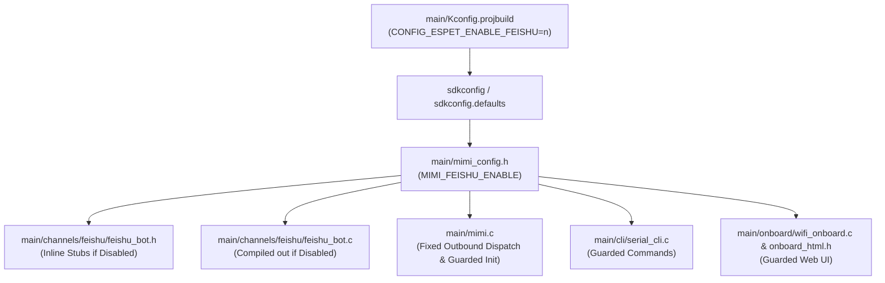

# Implementation Plan: Archive Feishu & Add sdkconfig Feature Toggle

## Goal Description
In the monitor CLI, outbound message delivery logs the following error on every cloud-routed reply:
```text
W (257886) feishu: Cannot send: no credentials configured
E (257886) mimi: Feishu send failed for -5358063159: ESP_ERR_INVALID_STATE
```
Root cause analysis revealed two intertwined issues:
1. **Outbound Dispatch Fallthrough Bug in `main/mimi.c`**: In `outbound_dispatch_task`, the preprocessor directives for `MIMI_CLOUD_LINK_ENABLE` and Feishu were incorrectly structured:
   ```c
   #if MIMI_CLOUD_LINK_ENABLE
           } else if (strcmp(msg.channel, MIMI_CHAN_CLOUD) == 0) {
               ...
           }
   #else
           } else if (strcmp(msg.channel, MIMI_CHAN_FEISHU) == 0) {
   #endif
               esp_err_t send_err = feishu_send_message(msg.chat_id, msg.content);
   ```
   When `MIMI_CLOUD_LINK_ENABLE` is `1` (the default Hybrid Mode), the `#else` block was omitted, leaving `feishu_send_message(msg.chat_id, msg.content)` directly attached to the cloud dispatch block without any conditional check. Thus, every message sent to Telegram via Cloud (`chat_id = -5358063159`) erroneously triggered `feishu_send_message()` as well.
2. **Always-On Active Feishu Subsystem**: Even with no Feishu credentials configured, `feishu_bot_init()` and `feishu_bot_start()` were unconditionally executed at boot in `main/mimi.c`, Feishu serial CLI commands were registered, and captive portal WiFi onboarding exposed Feishu fields.

This plan archives Feishu integration across the firmware, fixes the outbound dispatch routing logic, and introduces an ESP-IDF Kconfig (`CONFIG_ESPET_ENABLE_FEISHU`) toggle in `sdkconfig` (default `n` / disabled). When disabled, all Feishu code, tasks, commands, and allocations are compiled out entirely.

---

## User Review Required

> [!IMPORTANT]
> **Default Behavior Change**: Feishu bot integration will now be **disabled by default** (`CONFIG_ESPET_ENABLE_FEISHU=n` in `sdkconfig.defaults`).
> If Feishu is ever needed in the future, it can be re-enabled simply by toggling `CONFIG_ESPET_ENABLE_FEISHU=y` via `idf.py menuconfig` or setting `CONFIG_ESPET_ENABLE_FEISHU=y` in `sdkconfig`.

> [!NOTE]
> The outbound dispatch logic in `main/mimi.c` will be decoupled so each channel (`telegram`, `cloud`, `feishu`, `websocket`, `system`) has its own distinct block with no shared/nested preprocessor fallthrough.

---

## Open Questions
None. The root cause is completely diagnosed and reproducible, and the Kconfig toggle aligns with ESP-IDF standard conventions.

---

## Proposed Changes



---

### ESP-IDF Configuration & Kconfig

#### [NEW] `main/Kconfig.projbuild`
- Create top-level ESPET configuration menu with `CONFIG_ESPET_ENABLE_FEISHU`, defaulting to `n`:
```kconfig
menu "ESPET Configuration"

    config ESPET_ENABLE_FEISHU
        bool "Enable Feishu / Lark Bot Channel"
        default n
        help
            Enables Feishu / Lark messaging channel on the ESP32.
            Disabled by default to save SRAM, task stacks, and network sockets.
            When disabled, all Feishu tasks, credentials, and CLI commands
            are compiled out completely.

endmenu
```

#### [MODIFY] `sdkconfig.defaults` and `sdkconfig.defaults.esp32s3`
- Add explicit default toggle:
```ini
# Feishu / Lark bot integration (disabled by default)
CONFIG_ESPET_ENABLE_FEISHU=n
```

---

### Firmware Configuration & Core Dispatch

#### [MODIFY] `main/mimi_config.h`
- Define `MIMI_FEISHU_ENABLE` based on Kconfig `CONFIG_ESPET_ENABLE_FEISHU` (default `0`).
- Archive Feishu configuration constants under `#if MIMI_FEISHU_ENABLE`:
```c
/* Feishu Channel Enable Flag: controlled via Kconfig / sdkconfig */
#ifndef MIMI_FEISHU_ENABLE
#if defined(CONFIG_ESPET_ENABLE_FEISHU) && CONFIG_ESPET_ENABLE_FEISHU
#define MIMI_FEISHU_ENABLE 1
#else
#define MIMI_FEISHU_ENABLE 0
#endif
#endif

#if MIMI_FEISHU_ENABLE
#ifndef MIMI_SECRET_FEISHU_APP_ID
#define MIMI_SECRET_FEISHU_APP_ID ""
#endif
#ifndef MIMI_SECRET_FEISHU_APP_SECRET
#define MIMI_SECRET_FEISHU_APP_SECRET ""
#endif

/* Feishu Bot Configuration */
#define MIMI_FEISHU_MAX_MSG_LEN 4096
#define MIMI_FEISHU_POLL_STACK (12 * 1024)
#define MIMI_FEISHU_POLL_PRIO 5
#define MIMI_FEISHU_POLL_CORE 0
#define MIMI_FEISHU_WEBHOOK_PORT 18790
#define MIMI_FEISHU_WEBHOOK_PATH "/feishu/events"
#define MIMI_FEISHU_WEBHOOK_MAX_BODY (16 * 1024)

#define MIMI_NVS_FEISHU "feishu_config"
#define MIMI_NVS_KEY_FEISHU_APP_ID "app_id"
#define MIMI_NVS_KEY_FEISHU_APP_SECRET "app_secret"
#endif
```

#### [MODIFY] `main/mimi.c`
1. Guard `#include "channels/feishu/feishu_bot.h"` with `#if MIMI_FEISHU_ENABLE`.
2. Fix outbound dispatch channel routing in `outbound_dispatch_task`:
   - Decouple `MIMI_CHAN_CLOUD` from `MIMI_CHAN_FEISHU`.
   - Wrap `MIMI_CHAN_FEISHU` handling entirely within `#if MIMI_FEISHU_ENABLE`.
3. Guard startup calls in `app_main`:
   - `feishu_bot_init()` wrapped in `#if MIMI_FEISHU_ENABLE`.
   - `feishu_bot_start()` wrapped in `#if MIMI_FEISHU_ENABLE`.

---

### Feishu Channel Component

#### [MODIFY] `main/channels/feishu/feishu_bot.h`
- Include `mimi_config.h`.
- When `MIMI_FEISHU_ENABLE` is `0`, provide inline no-op / `ESP_ERR_NOT_SUPPORTED` stubs for `feishu_bot_init()`, `feishu_bot_start()`, `feishu_send_message()`, `feishu_reply_message()`, and `feishu_set_credentials()`. This guarantees safe linking even if any external translation unit invokes them.

#### [MODIFY] `main/channels/feishu/feishu_bot.c`
- Wrap entire file implementation inside `#if MIMI_FEISHU_ENABLE` so it compiles to an empty translation unit when disabled, allocating 0 tasks, 0 heap buffers, and 0 flash strings.

---

### CLI & WiFi Onboarding

#### [MODIFY] `main/cli/serial_cli.c`
- Guard `feishu_creds_args`, `feishu_send_args`, `cmd_set_feishu_creds`, `cmd_feishu_send`, and their registrations under `#if MIMI_FEISHU_ENABLE`.

#### [MODIFY] `main/onboard/wifi_onboard.c` & `main/onboard/onboard_html.h`
- Guard `feishu_app_id` and `feishu_app_secret` reading/writing in `wifi_onboard.c` with `#if MIMI_FEISHU_ENABLE`.
- Guard HTML card and field registration in `onboard_html.h` with `#if MIMI_FEISHU_ENABLE`.
- Add null-check safety to JavaScript `save()` in `onboard_html.h` to prevent DOM lookup errors if any section is excluded.

---

### Dashboard & Project Docs

#### [MODIFY] `espet-backend/src/views/Device.tsx`
- Update channel listing in the Web Dashboard so Feishu is clearly labeled as Archived / Disabled rather than active.

#### [MODIFY] `.agent/SYSTEM_OVERVIEW.md`
- In accordance with the mandatory **Session Memory Rule**, update:
  - System channels section noting Feishu is disabled by default via Kconfig toggle `CONFIG_ESPET_ENABLE_FEISHU`.
  - Append an entry to the "Recent Changes" log.

---

## Verification Plan

### Automated Tests / Compilation Verification
1. Export ESP-IDF v5.5.4 environment via PowerShell profile:
   ```powershell
   & C:\Espressif\tools\Microsoft.v5.5.4.PowerShell_profile.ps1
   ```
2. Perform full clean & rebuild firmware:
   ```powershell
   idf.py fullclean
   idf.py build
   ```
3. Verify `mimiclaw.bin` compiles cleanly with no linker errors, warnings, or missing symbols.
4. Verify `sdkconfig` contains:
   `# CONFIG_ESPET_ENABLE_FEISHU is not set` or `CONFIG_ESPET_ENABLE_FEISHU=n`.

### Manual / Device Verification
1. Boot the device and observe serial monitor:
   - Confirm no `feishu: Cannot send: no credentials configured` warning.
   - Confirm no `mimi: Feishu send failed for ...` error.
   - Confirm `MIMI_CHAN_CLOUD` replies send cleanly to Telegram with only `Cloud send success`.
2. Inspect Serial CLI:
   - `help` no longer registers `set_feishu_creds` or `feishu_send` when disabled.
