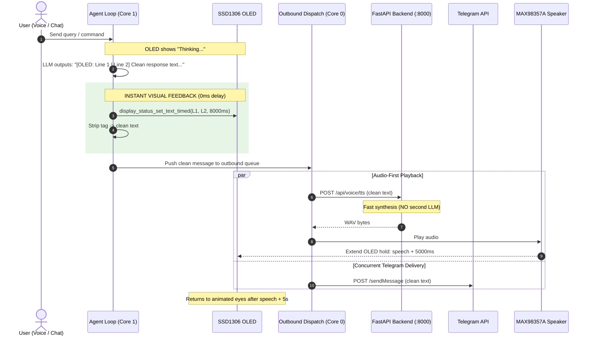

# Implementation Plan: Ultra-Low Latency OLED Display & Synchronized Output for ESPET

## Goal Description
Currently, ESPET updates its 128x64 SSD1306 OLED screen with response text only after a long sequential pipeline:
1. Agent completes reasoning on ESP32 Core 1.
2. Outbound dispatch sends message to Telegram (blocking 800ms–2000ms).
3. Backend `/api/voice/tts` is called, which calls a **second LLM** (`extract_oled_keywords_llm`) concurrently with `edge-tts` (adding 1500ms–3000ms).
4. ESP32 waits for the full TTS WAV to finish downloading before updating the OLED screen.
5. The OLED immediately reverts to the animated idle face as soon as speech finishes, leaving insufficient time to read.

This plan restructures the flow to achieve **minimum end-to-end latency**:
- **Single-Pass LLM Tagging**: System prompt instructs the main model to output `[OLED: Line 1 | Line 2]` directly in its first tokens. Distillation latency drops to **0ms** (eliminates secondary LLM).
- **Instant OLED Display**: As soon as the LLM finishes reasoning in `agent_loop.c`, OLED displays the 2-line summary **immediately** (<1ms visual feedback).
- **Readability Hold Duration**: OLED holds the summary for the **entire speech duration + 5s buffer (minimum 8s total)** before transitioning back to animated eyes.
- **In-Place Tag Stripping**: The `[OLED: ...]` tag is stripped in-place before saving to session history, sending to Telegram/WebSocket, and synthesizing TTS.
- **Audio-First Outbound Dispatch**: In `outbound_dispatch_task`, TTS audio fetch & playback begins **immediately** without waiting for Telegram's network roundtrip.
- **Backend TTS Optimization**: Strips the blocking secondary LLM summarizer from `espet-backend/api/voice_router.py`, speeding up `/api/voice/tts` by 1.5–3 seconds.

---

## User Review Required

> [!IMPORTANT]
> - **Prompt Contract**: The main model will be instructed to include `[OLED: Line 1 | Line 2]` at the beginning of final responses. If the model ever omits the tag, a local fallback (`word_wrap_oled`) takes over immediately so OLED display never fails.
> - **Telegram Cleanliness**: The `[OLED: ...]` tag will be completely stripped before sending to Telegram so chat users only see the clean response text.
> - **Backend Change**: `/api/voice/tts` on `espet-backend` will stop calling the secondary LLM for OLED extraction, relying on instant heuristic extraction if headers are requested.

---

## Open Questions
*None — all key decisions were resolved during the `/grill-me` alignment phase.*

---

## Architecture & Data Flow



---

## Proposed Changes

### 1. Firmware: Context Builder & System Prompt
Update the system prompt in `main/agent/context_builder.c` to instruct the LLM on the `[OLED: Line 1 | Line 2]` format.

#### [MODIFY] `main/agent/context_builder.c`
```c
// Add OLED formatting rule to system prompt:
"## OLED Display Format Rule\n"
"Every final conversational response MUST begin with an OLED summary tag in this exact format:\n"
"[OLED: Line 1 | Line 2]\n"
"Followed immediately by your natural conversational response.\n"
"Rules:\n"
"1. Line 1 and Line 2 must each be <= 16 ASCII characters (English or Pinyin only).\n"
"2. Distill the most important action, status, or key answer into those two lines.\n"
"3. Example: [OLED: Status LED | State: ON] I have turned on the status LED for you.\n\n"
```

---

### 2. Firmware: Display Status & Hold Timer
Add timed hold and deferral logic in `main/display/display_status.h` and `main/display/display_status.c` so the text stays visible for at least 8 seconds or speech + 5 seconds before returning to the animated face.

#### [MODIFY] `main/display/display_status.h`
```c
/**
 * @brief Display 2 lines of text and hold for at least min_hold_ms before allowing
 *        a transition back to the animated idle face.
 */
void display_status_set_text_timed(const char *line1, const char *line2, uint32_t min_hold_ms);

/**
 * @brief Extend the current text hold duration (e.g. called after speech ends).
 */
void display_status_extend_hold(uint32_t extra_ms);

/**
 * @brief Check whether text display hold is currently active.
 */
bool display_status_is_held(void);
```

#### [MODIFY] `main/display/display_status.c`
- Implement `s_text_hold_until_us`.
- In `display_status_set_text_timed(line1, line2, min_hold_ms)`:
  - Set `s_text_hold_until_us = esp_timer_get_time() + ((int64_t)min_hold_ms * 1000)`.
  - Render text via `display_status_output`.
- In `display_status_idle()`:
  - If `esp_timer_get_time() < s_text_hold_until_us`, do not revert to `FACE_STATE_IDLE`.
- In `oled_anim_task` (or a 1-second check timer):
  - When `s_text_hold_until_us` expires and state is `FACE_STATE_TEXT`, automatically revert to `FACE_STATE_IDLE`.

---

### 3. Firmware: Agent Loop (Core 1)
Parse and strip `[OLED: ...]` immediately upon LLM response completion in `main/agent/agent_loop.c`.

#### [MODIFY] `main/agent/agent_loop.c`
- Add helper `extract_and_strip_oled_tag(char *text, char *out_l1, size_t l1_sz, char *out_l2, size_t l2_sz)`.
- When `final_text` is obtained:
  ```c
  char oled_l1[17] = {0};
  char oled_l2[17] = {0};
  if (extract_and_strip_oled_tag(final_text, oled_l1, sizeof(oled_l1), oled_l2, sizeof(oled_l2))) {
      display_status_set_text_timed(oled_l1, oled_l2, 8000);
  } else {
      /* Fallback word wrap if tag omitted */
      word_wrap_oled(final_text, oled_l1, sizeof(oled_l1), oled_l2, sizeof(oled_l2));
      display_status_set_text_timed(oled_l1, oled_l2, 8000);
  }
  ```
- Remove premature `display_status_idle()` call at end of loop so the timer can run.

---

### 4. Firmware: Audio-First / Concurrent Outbound Dispatch
Update `main/mimi.c` so audio playback starts immediately without waiting for Telegram's network roundtrip.

#### [MODIFY] `main/mimi.c`
- For system `"voice"` messages and regular Telegram responses:
  - If speech is enabled (`should_speak_reply(msg.content)`):
    - Trigger `voice_client_speak(msg.content)` immediately (or via dedicated audio worker task).
    - Telegram send executes concurrently or immediately after audio fetch is started.
- In `voice_client.c`:
  - When playback of WAV finishes in `voice_speak_internal`:
    - Call `display_status_extend_hold(5000);` (user choice: speech duration + 5s buffer).

---

### 5. Backend: Fast TTS Endpoint
Remove the slow secondary LLM summarizer from `espet-backend/api/voice_router.py`.

#### [MODIFY] `espet-backend/api/voice_router.py`
- In `POST /api/voice/tts`:
  - Replace `asyncio.gather(_tts_to_wav, extract_oled_keywords_llm)` with direct `await _tts_to_wav(text, voice)`.
  - For headers `X-OLED-Line1` / `Line2`, use `extract_oled_keywords(req.text)` (the instant <1ms regex heuristic).
  - This eliminates 1.5–3.0s of latency on every TTS generation!

---

### 6. Documentation & Session Overview
#### [MODIFY] `.agent/SYSTEM_OVERVIEW.md`
- Update OLED display subsystem, voice pipeline architecture, and log the change in Recent Changes.

---

## Verification Plan

### Automated Tests / Compilation
1. Run ESP-IDF build verification:
   ```powershell
   # Windows PowerShell
   . $env:IDF_PATH\export.ps1
   idf.py build
   ```
2. Verify Python backend starts and passes syntax checks:
   ```powershell
   cd espet-backend
   python -m py_compile api/voice_router.py services/oled_summarizer.py
   ```

### Manual Verification
1. **OLED Immediate Display Test**:
   - Send command via Telegram or Voice: *"Turn on the white LED"*.
   - Check OLED: Screen must immediately update to:
     ```
     Status LED
     State: ON
     ```
     *before* the speaker starts talking and *before* Telegram finishes delivery.
2. **Readability Hold Duration Test**:
   - Measure time the 2-line summary stays on the OLED screen.
   - Confirm it stays visible during speaker playback and for at least 5 seconds after speech stops (minimum 8 seconds total), then smoothly transitions back to animated eyes.
3. **Clean Chat & Voice Output Test**:
   - Check Telegram message: Verify `[OLED: ...]` is completely absent from the chat bubble.
   - Check Speaker audio: Verify the speaker never pronounces "[OLED]" or the OLED lines aloud; it only speaks the conversational answer.
4. **Latency Measurement**:
   - Compare serial timestamps before and after change:
     - Old: LLM finish -> Telegram POST (1.5s) -> TTS fetch + LLM distillation (2.5s) -> OLED update (total 4.0s+).
     - New: LLM finish -> OLED update (<5ms) -> TTS audio plays (1.0s).
