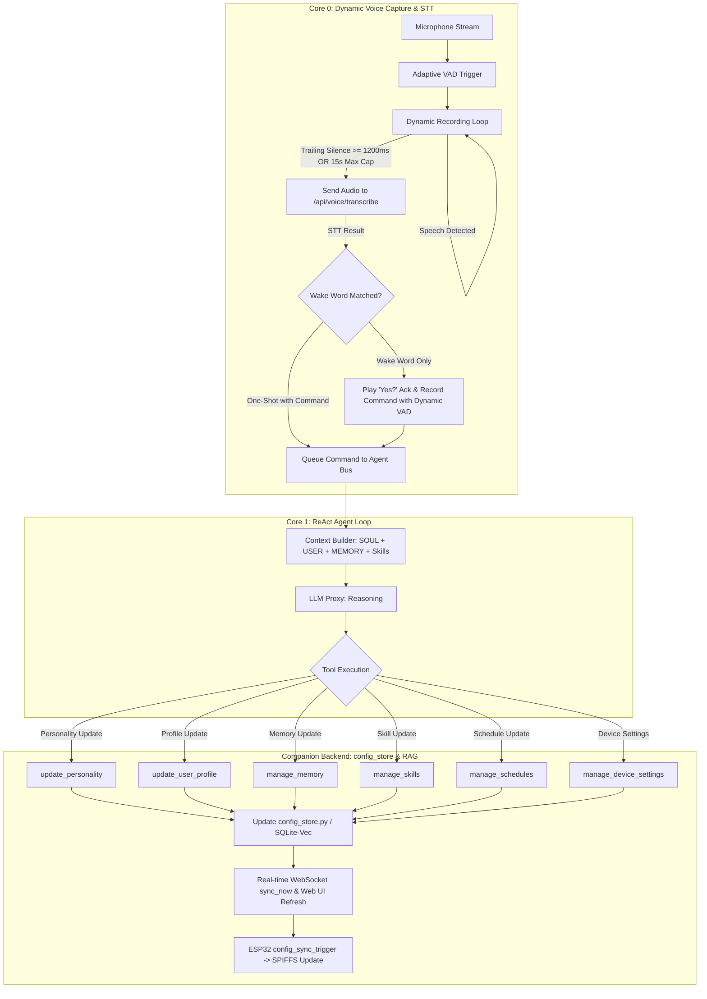

# Implementation Plan: ESPET Voice Self-Modification & Dynamic VAD Listening

Enable ESPET to modify its own personality, user profile, memories, schedules, and skills via voice commands—mirroring everything on the `http://localhost:8000/#assistant` dashboard—and replace the fixed-duration voice recording with a flexible dynamic VAD system that cuts off on 1200 ms of trailing silence (up to 15 s max cap).

---

## Architecture Overview



---

## User Review Required

> [!IMPORTANT]
> - **Unified VAD Window**: Utterance capture duration will no longer be artificially constrained to 2.5 seconds. Speaking naturally for 5–10 seconds (e.g. giving long personality instructions) will stay open and only finalize when 1200 ms of silence is detected.
> - **Backend Single Source of Truth**: Self-modifications executed by the LLM will update `config_store.py` directly, triggering instantaneous real-time sync down to the ESP32 SPIFFS (`/spiffs/config/SOUL.md`, `/spiffs/config/USER.md`, `/spiffs/skills/`, etc.) and instantly updating the `http://localhost:8000/#assistant` dashboard without reload.
> - **Excluded Scope**: Per requirements, WiFi credentials, LLM model provider/selection, and backend core system settings will remain protected and cannot be altered via voice self-modification.

---

## Proposed Changes

### Component 1: Dynamic VAD & Flexible Listening (`main/voice/voice_client.c`)

#### [MODIFY] `main/voice/voice_client.c`
- **Dynamic Utterance Window**:
  - Replace `UTTERANCE_MAX_MS` (2500 ms) with a flexible max duration: `VOICE_MAX_RECORD_MS` (15000 ms).
  - Unify trailing silence endpointing across both wake utterance capture and command phase to `CMD_SILENCE_MS = 1200` ms.
  - In `voice_task` (wake loop): Keep recording while speech energy is detected. Calculate trailing silence from `last_voice_ms`. When `now - last_voice_ms >= CMD_SILENCE_MS`, stop recording immediately and send to STT.
  - In `voice_run_command` (two-step wake): Ensure the command phase also uses the 1200 ms trailing silence and up to 15 s cap.
- **Immediate SPIFFS Sync Hook**:
  - When `tool_registry.c` executes any configuration tool, call `config_sync_trigger()` to pull the latest version immediately into SPIFFS flash without waiting for the 5-minute background sync timer.

```c
// Key parameter changes in main/voice/voice_client.c:
#define UTTERANCE_MAX_MS       15000        /* Generous 15s hard cap for one-shot commands */
#define CMD_MAX_MS             15000        /* Generous 15s hard cap for command phase */
#define CMD_SILENCE_MS         1200         /* 1.2s trailing silence cutoff */
#define CMD_MIN_SPEECH_MS      300          /* Minimum speech required to validate utterance */
```

---

### Component 2: Self-Modification Backend Tools (`espet-backend/api/custom_tools.py`)

#### [MODIFY] `espet-backend/api/custom_tools.py`
Register and implement dedicated self-modification tools in `CUSTOM_TOOLS`:

1. **`update_personality`**:
   - Parameters:
     - `preset`: Optional preset ID (`default`, `robotic_pet`, `butler`, `scholar`).
     - `personality_traits`: Optional list or string of traits to append or update (e.g. "sarcastic, humorous").
     - `behavior_rules`: Optional rules to add or update (e.g. "always give concise one-line answers").
     - `full_content`: Optional raw markdown for complete customization.
   - Action: Reads current `soul_md` via `config_store.get_config()`, patches or loads preset, writes via `config_store.update_markdown("soul", new_content)`, triggers `notify_device_sync()`.

2. **`update_user_profile`**:
   - Parameters:
     - `name`: User's preferred name / nickname.
     - `language`: Preferred speaking language (e.g. "English", "Chinese").
     - `timezone`: IANA timezone (e.g. "Asia/Kuala_Lumpur").
     - `preferences`: Bullet points to add or update (e.g. "prefers dark coffee", "works in software").
     - `full_content`: Optional raw markdown to overwrite.
   - Action: Updates `user_md` in `config_store.py` while preserving existing preferences, writes via `config_store.update_markdown("user", new_content)`, triggers `notify_device_sync()`.

3. **`manage_memory`**:
   - Parameters:
     - `action`: `"save"`, `"update"`, `"forget"`, `"search"`, or `"append_working_note"`.
     - `content`: Memory text or note.
     - `category`: `"fact"`, `"preference"`, `"routine"`, `"event"`.
     - `query`: Search or target query for update/forget.
   - Action: Unifies SQLite-Vec vector memory operations with on-device `MEMORY.md` working notes.

4. **`manage_skills`**:
   - Parameters:
     - `action`: `"create"`, `"update"`, `"delete"`, `"toggle"`, or `"list"`.
     - `name`: Skill slug (e.g. `weather-alerts`).
     - `content`: Markdown skill instructions.
     - `enabled`: Boolean toggle.
   - Action: Calls `config_store.add_skill()`, `config_store.update_skill()`, or `config_store.delete_skill()`, then triggers `notify_device_sync()`.

5. **`manage_schedules`**:
   - Parameters:
     - `action`: `"create"`, `"update"`, `"delete"`, `"list"`.
     - `name`: Job name.
     - `schedule_type`: `"every"` (interval) or `"at"` (epoch timestamp).
     - `interval_s`: Interval in seconds.
     - `message`: Trigger prompt injected when job fires.
   - Action: Uses `config_store.add_job()`, `config_store.update_job()`, or `config_store.delete_job()`, syncing down to the device's `cron.json`.

6. **`manage_device_settings`**:
   - Parameters:
     - `name`: Device display name (e.g. "Mimi Bedroom").
     - `timezone`: IANA timezone.
   - Action: Calls `config_store.update_device_settings()`, updates device metadata and POSIX timezone.

---

### Component 3: Tool Discovery & Tool Registration Sync (`main/tools/tool_registry.c`)

#### [MODIFY] `main/tools/tool_registry.c`
- When `tool_registry_sync_remote()` runs, ensure the newly added backend self-modification tools (`update_personality`, `update_user_profile`, `manage_memory`, `manage_skills`, `manage_schedules`, `manage_device_settings`) are parsed and added to `s_tools` for the LLM prompt.
- After a tool execution succeeds for any config/memory tool, trigger `config_sync_trigger()` so the ESP32 local SPIFFS partition updates within seconds.

---

### Component 4: System Prompt & Guidance (`main/agent/context_builder.c`)

#### [MODIFY] `main/agent/context_builder.c`
- Add explicit self-modification guidance to `context_build_system_prompt()`:
  - Explain that ESPET possesses autonomous agency over its own personality, user profile, memory, schedules, and skills.
  - Instruct the model: "When the user asks you to change how you speak, update your personality, remember facts about them, adjust schedules, or create new skills, call the corresponding self-modification tool (`update_personality`, `update_user_profile`, `manage_memory`, `manage_skills`, `manage_schedules`) immediately. Confirm the update with an energetic voice response and an OLED summary tag."

---

## Verification Plan

### Automated Tests & Syntax Verification
1. **Backend Unit / Smoke Checks**:
   - Run Python validation script on `espet-backend/` checking tool schemas, execution functions, and `config_store` mutations.
   - Verify all endpoints in `config_router.py` and `tools_router.py` pass health checks.
   ```powershell
   cd espet-backend
   python -c "import config_store; from api.custom_tools import CUSTOM_TOOLS; print(f'Registered {len(CUSTOM_TOOLS)} tools')"
   ```

2. **Firmware Compilation Verification**:
   - Verify clean build with ESP-IDF v5.5.x:
   ```powershell
   idf.py build
   ```

### Manual Verification
1. **Dynamic VAD & Silence Detection**:
   - Speak a long prompt to ESPET (e.g. "Hey ESPET, I want you to remember that my favorite beverage is iced black coffee with oat milk and update your tone to be witty and concise").
   - Confirm that the recording stays active throughout the speech and terminates exactly ~1.2s after you stop speaking.
   - Verify speech is transcribed in full without cutoff.
2. **Personality Modification**:
   - Voice command: *"Hey ESPET, switch your personality to Robotic Pet"*
   - Verify ESPET replies with playful robotic cues (`*chirp*`, `*beep*`) and sets `[OLED: Personality | Robotic Pet]`.
   - Inspect `http://localhost:8000/#assistant` -> Personality card updates immediately.
3. **User Profile Modification**:
   - Voice command: *"Hey ESPET, my name is Herman and I speak English and Chinese"*
   - Verify `USER.md` updates with `Name: Herman` and `Language: English / Chinese`.
4. **Skill Creation**:
   - Voice command: *"Hey ESPET, add a skill called 'joke-teller' to tell me a quick tech joke when I ask"*
   - Verify `joke-teller.md` appears under Skills on the Assistant page and in `/spiffs/skills/joke-teller.md`.
5. **Memory Management**:
   - Voice command: *"Hey ESPET, remember that my project presentation is on December 11th"*
   - Verify it is saved into long-term vector memory and visible in the Memory section of `http://localhost:8000/#assistant`.
